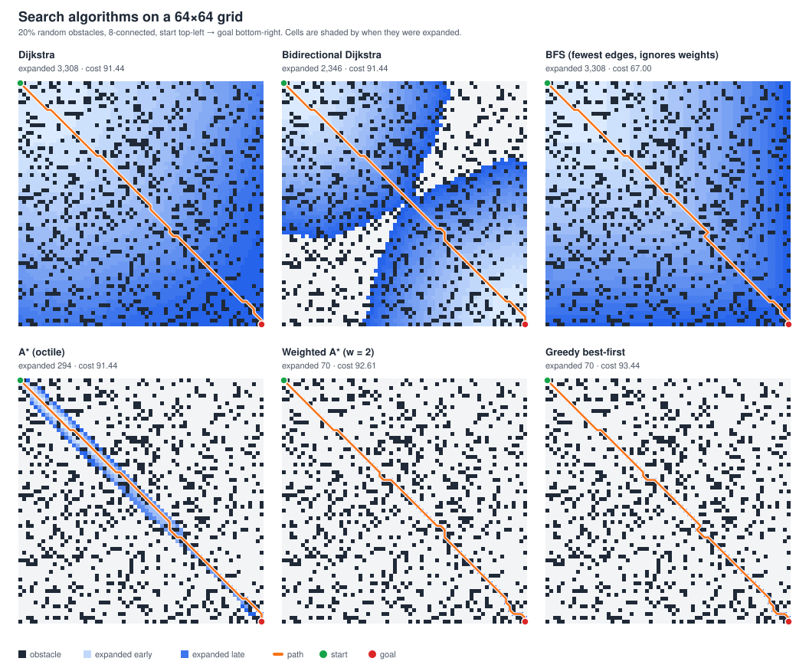
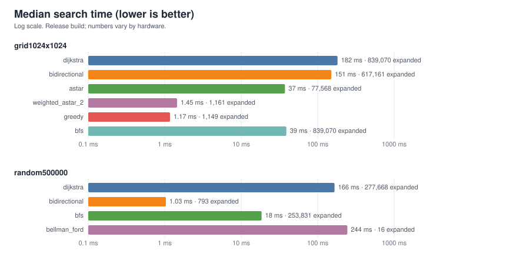
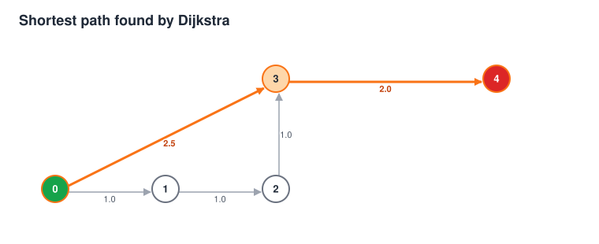

# graphSearch

A header-only C++20 library of shortest-path algorithms on weighted directed graphs, plus a YAML-driven CLI, tests, benchmarks and CI.

| Algorithm | Function | Notes |
|---|---|---|
| Dijkstra | `dijkstra` | non-negative weights |
| A\* | `astar` | optimal with an admissible heuristic; inconsistent heuristics are handled (nodes are re-opened) |
| Weighted A\* | `weightedAstar` | priority `g + w·h`, cost ≤ `w ×` optimal |
| Greedy best-first | `greedyBestFirst` | fast, not optimal |
| Bidirectional Dijkstra | `bidirectionalDijkstra` | pass `g.reversed()` to reuse it across queries |
| BFS | `bfs` | fewest edges |
| Bellman-Ford | `bellmanFord` | negative weights, detects reachable negative cycles |

## Visualizations



Cells are shaded by when each algorithm expanded them (light = early, dark = late), so you can see Dijkstra flooding in every direction, bidirectional search meeting in the middle, and A\* hugging the path. Weighted A\* and greedy expand so few cells that they hide under the path line.



For graphs with coordinates, the CLI can draw the graph and highlight the path:



Regenerate all three (plain SVG, no extra dependencies):

```bash
./build/visualize_grid 64 0.2 42 docs/images/grid_comparison.svg   # size, obstacle ratio, seed, output
./build/graphSearch config/graph.yaml --svg docs/images/graph.svg
./build/bench --svg docs/images/benchmarks.svg
```

Every search function accepts an optional `std::vector<NodeId>* trace` that receives the expanded nodes in order, and `graphsearch/svg.hpp` has the renderers, so you can draw your own searches.

## Layout

```
include/graphsearch/   header-only library: graph.hpp (CSR graph), search.hpp, heuristics.hpp, svg.hpp
src/                   YAML loader (config.*) and CLI (main.cpp)
config/graph.yaml      sample problem
tests/                 unit tests, run with ctest
benchmarks/            benchmark harness + grid / random-graph generators
examples/              grid_astar.cpp, visualize_grid.cpp
docs/images/           generated SVGs used in this README
cmake/                 package config for find_package(graphsearch)
```

## Build

Requires CMake ≥ 3.14 and a C++20 compiler. yaml-cpp is only needed for the CLI (`-DGRAPHSEARCH_BUILD_APP=OFF` to skip it).

```bash
cmake -S . -B build
cmake --build build -j
ctest --test-dir build --output-on-failure
```

Options: `GRAPHSEARCH_BUILD_TESTS`, `GRAPHSEARCH_BUILD_BENCHMARKS`, `GRAPHSEARCH_WERROR`, `GRAPHSEARCH_SANITIZE` (ASan + UBSan).

## Use as a library

```cpp
#include <graphsearch/search.hpp>
using namespace graphsearch;

Graph<double> g(5);
g.addEdge(0, 1, 1.0);
g.addEdge(1, 4, 2.0);
g.finalize();                                  // packs edges into CSR; required before searching

auto r = dijkstra(g, 0, 4);                    // r.found, r.path, r.cost, r.expanded
auto a = astar(g, 0, 4, gridOctile<double>(width));
```

Install and consume from another project:

```bash
cmake --install build --prefix /opt/graphsearch
```
```cmake
find_package(graphsearch REQUIRED)
target_link_libraries(app PRIVATE graphsearch::graphsearch)
```

Heuristics: `zeroHeuristic`, `euclidean`, `manhattan`, `octile` (from node coordinates) and `gridOctile` (from ids on a row-major grid). Any `(NodeId, NodeId) -> Cost` callable works.

## CLI and YAML

```bash
./build/graphSearch config/graph.yaml
```

```yaml
totalNodes: 5
startNode: 0
goalNode: 4
nodes:                       # optional; enables coordinate heuristics
  - {id: 0, x: 0, y: 0}
edges:
  - {source: 0, destination: 1, weight: 1}
searchAlgorithms:
  - type: Dijkstra           # Dijkstra | Bidirectional | BellmanFord | BFS
  - type: AStar              # AStar | WeightedAStar | Greedy
    heuristic: euclidean     # zero | euclidean | manhattan | octile (default: euclidean if nodes given, else zero)
  - type: WeightedAStar
    heuristic: euclidean
    weight: 1.5
```

## Benchmarks

```bash
./build/bench                 # table
./build/bench --csv           # or --json, for tracking over time
./build/bench --quick         # small sizes (used in CI)
```

Release build, median of several runs, on this CI-class machine (numbers vary by hardware). Grids are N×N, 8-connected, 20% obstacles, corner to corner.

| Scenario | Algorithm | ms | expanded | cost |
|---|---|---|---|---|
| grid 1024² | Dijkstra | 136 | 839,070 | 1487.75 |
| grid 1024² | Bidirectional | 135 | 617,161 | 1487.75 |
| grid 1024² | **A\*** (octile) | **28** | 77,568 | 1487.75 |
| grid 1024² | Weighted A\* (w=2) | 1.3 | 1,161 | 1512.49 (+1.7%) |
| grid 1024² | Greedy | 1.2 | 1,149 | 1530.67 (+2.9%) |
| random 500k nodes, 2.5M edges | Dijkstra | 176 | 277,668 | 42 |
| random 500k nodes, 2.5M edges | **Bidirectional** | **1.3** | 793 | 42 |
| random 500k nodes, 2.5M edges | Bellman-Ford | 259 | 16 passes | 42 |

On grids, A\* with a good heuristic wins; on sparse random graphs (no usable heuristic), bidirectional search wins by orders of magnitude. All exact algorithms return identical costs.

## Testing

`ctest` runs unit tests that cross-check every algorithm against Floyd-Warshall on hundreds of random graphs (including negative weights for Bellman-Ford), check A\* ≡ Dijkstra on random grids, cover an inconsistent-heuristic case, input validation, CSR behaviour, and the YAML loader. CI runs GCC and Clang (Debug and Release, `-Werror`), an ASan/UBSan job, and an install + `find_package` check.

## License

MIT, see LICENSE.
